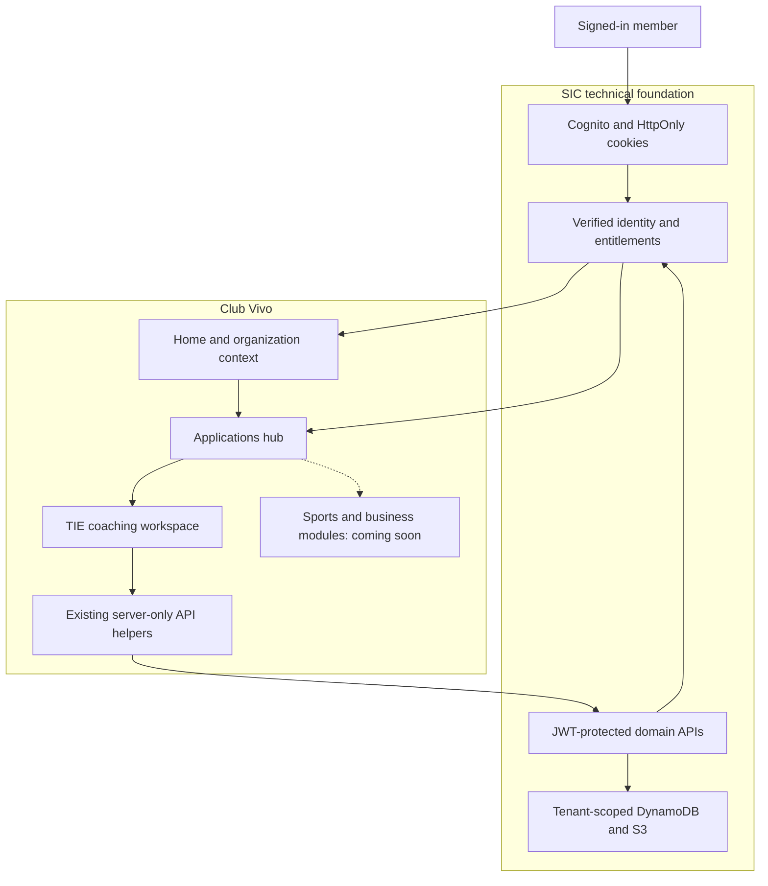

# Club Vivo on SIC

Club Vivo is one modular Sports and Business Intelligence product. TIE is the first flagship application; SIC is its protected technical foundation.

The existing Session Builder, Quick Soccer Game, Teams, Equipment Essentials, Methodology, saved sessions, feedback, and exports remain inside TIE with unchanged URLs and backend contracts. Planned modules have no launch action.

Role-aware presentation uses the existing authenticated `/me` response. SIC remains the authority for tenant scope, action permissions, and storage boundaries. The application catalog does not grant entitlements or add a separate auth path.

Private environment configuration and server-side bearer-token API calls remain the integration boundary. Existing architecture PNGs depict the earlier coaching baseline; this diagram shows Home v1's product framing.
