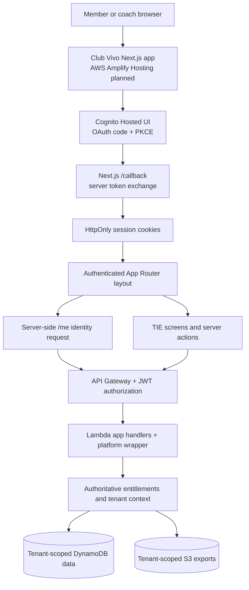
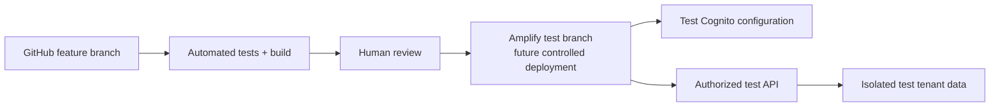
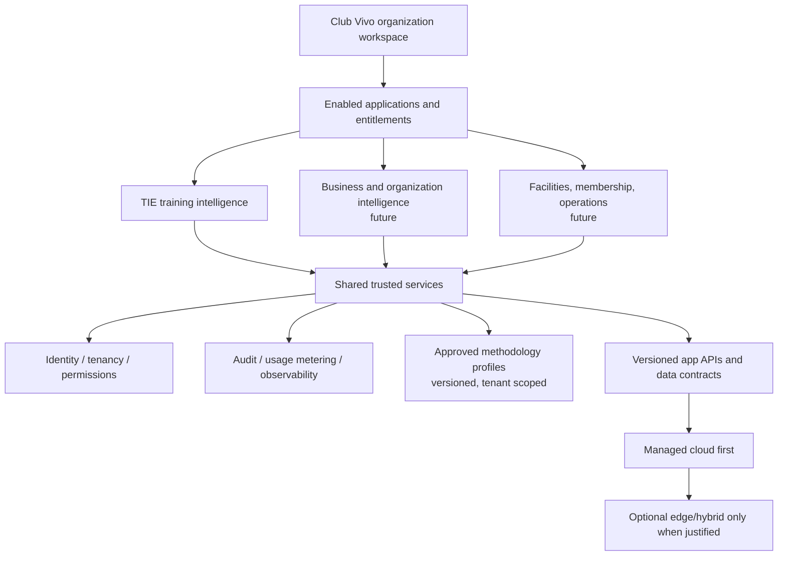

# Club Vivo — System Architecture v0.1

**Status:** Current-source architecture review plus a separate future-state design. **Not a claim of deployed, certified, or end-to-end tested functionality.**  
**Branch reviewed:** `feat/club-vivo-salt-design`, stacked on `feat/club-vivo-home`.  
**Deployment decision:** AWS Amplify Hosting is preferred for the full Next.js application, but this design branch is **not deployed**.  
**Updated:** 2026-10-13 (America/New_York).

## 1. What we are architecting

**Club Vivo** is one SaaS experience with organization Home, modular applications and trusted role-specific entry points. **TIE** is its first active application. Today, TIE exposes soccer coaching tools backed by existing API endpoints. The future product may add deeper match-to-training intelligence and business applications without creating a separate customer-facing login or product.

**Important naming boundary:** Legacy names in source code, environment variables and engineering records describe implementation history. New public product surfaces should use *Club Vivo* and *TIE*. Internal documentation must preserve true file names, endpoint names and dependencies.

## 2. Current frontend structure (unmerged source)

- Framework: Next.js App Router + React + TypeScript + Tailwind CSS.
- Public: `app/page.tsx`, `app/login/page.tsx`, `app/login/start/route.ts`, `app/callback/route.ts`, `app/logout/route.ts`.
- Authenticated shell: `app/(protected)/layout.tsx` + `components/coach/CoachAppShell.tsx`; server fetch of `/me`.
- Home and app discovery: `app/(protected)/home/page.tsx`, `applications/page.tsx`, `organization/page.tsx`, `tie/page.tsx`.
- App catalog and UI policy: `lib/application-catalog.ts` and `lib/platform-navigation.ts`. **These control presentation only**, not backend access.
- Existing TIE workflows: `app/(protected)/sessions/`, `teams/`, `equipment/`, `methodology/`, and existing coach components.
- Backend adapter: `lib/api.ts`, `lib/auth.ts`, `lib/get-current-user.ts`, `lib/session-builder-api.ts`, team and methodology helpers.
- Supporting diagram/output code: `components/coach/DrillDiagramView.tsx`, `ActivityOutput.tsx`, and typed contracts under `lib/types/`.

The UI design branch uses a SALT-inspired dark dashboard shell, but it **does not import SALT data, AWS architecture or its role model**.

## 3. Actual request path

The following Mermaid diagram describes the existing source architecture. The Amplify box is the **intended hosting target**; it does not mean this branch has been deployed there.

**Interpretation:**
1. The browser enters the public site or `/login/start`.
2. Cognito authenticates the user; a state/PKCE-protected callback exchanges the code.
3. The Next.js server stores access/identity token material in HttpOnly cookies according to current auth helpers.
4. A cookie-presence routing guard provides an early redirect; it is **not** the actual authorization decision.
5. The protected server layout calls `/me` using the bearer token. Invalid or revoked access must deny service.
6. The existing backend derives trusted tenant context from verified identity and authoritative entitlements; the browser does not get to select an arbitrary tenant.
7. Existing TIE creation, save, read, feedback and export operations use their retained endpoints and server actions; backend controls authorization and data access.

**Dependency caveat:** This is grounded in repository code and its architecture contracts. We have **not** exercised this new branch against real Cognito and production AWS resources. The earlier Home PR reported local mock/smoke testing.

## 4. Security and tenant-boundary architecture

### Current engineering requirements

- The user cannot assign their own tenant by sending `tenant_id`, `tenantId` or `x-tenant-id`.
- Client navigation and hidden/showing app cards must never be interpreted as authorization.
- JWT/entitlement validation and tenant-scoped data access stay in backend code, not browser components.
- Current trusted workspace metadata includes `userId`, `tenantId`, `role` and `tier`; it is **not a complete club organization profile**.
- App-tier or nonprofit pricing must not weaken isolation.
- On absent or invalid entitlement context, deny rather than guess or fall back to another tenant.
- Keep access tokens out of client rendering, logs, documentation and URLs.
- No new user/club management endpoint is introduced by a read-only Home.

### Remaining validation work

- Test revoked access, missing entitlements, role changes and cross-tenant denial against an authorized test environment.
- Trace all server actions, protected endpoints, data access and S3 exports.
- Verify privacy retention, logging minimization, age-related permissions, and relevant youth safeguarding requirements before use by actual minors.
- Review the Next.js server/browser boundary, caching behavior, CSRF-sensitive mutations, rate limits and data deletion behavior as product capabilities evolve.

## 5. Hosting and environments

### Preferred hosting: AWS Amplify

The current repository contains `amplify.yml`, builds with `npm ci` and `npm run build`, and outputs `.next`. It relies on server-side Next.js behavior: callback route handlers, authenticated server-rendered pages, cookies and server actions.

**Therefore a simple static S3 + CloudFront upload is not a drop-in host for this app.** Hosting the full app as static files alone would lose those runtime capabilities. We retain managed Next.js hosting via Amplify as the preferred direction.

**State today:** GitHub draft PRs, not a live rollout of this redesign. Release must be explicitly approved; frontend hosting choice does not authorize modifying AWS resources.

### Pre-deployment checklist

- Validate **actual Amplify support/adapter compatibility** for the lockfile's Next.js `16.2.2`; document supported version, build logs and runtime behavior.
- Replace broad `latest` dependency declarations with an approved pinning/update policy in a separate code change; test before deployment.
- Set controlled test branch access; avoid unaudited public preview exposure.
- Verify Cognito allowed redirect and sign-out URLs and cookie domain/secure flags.
- Review `amplify.yml` handling of `CLUB_VIVO_*` environment variables; keep secrets in approved server-side settings, never embedded into client assets.
- Use scoped test backend, separate test data, minimum IAM permissions, logging and cost budgets/alerts.
- Test callback, expiration, logout, protected routes, denial cases, saved TIE work and responsive browser behavior.
- Estimate Amplify SSR execution and transfer, Cognito, API Gateway, Lambda, DynamoDB, S3 and any AI model inference **separately**.

## 6. What exists vs what is planned

| Capability | Source/meaning | Status |
| --- | --- | --- |
| Club Vivo Home, sidebar and applications catalog | Unmerged Next.js branch | Implemented in PR source; final browser QA pending |
| Read-only role/plan context | Existing authenticated `/me` response | Source-backed; test integration pending |
| TIE soccer session planning, saved work, feedback/export | Existing frontend and backend contracts | Existing paths; must regression-test live |
| Text-based tenant methodology | Existing backend scoped `shared`, `travel`, `ost` | Implemented narrowly; influence on generation limited |
| Match evidence to Training Brief draft | Backend internal candidate/handoff and narrow preview path in SIC source | Prototype/source-present, **not** full coaching intelligence |
| Club-selected arbitrary methodology library | New proposed domain and approval model | Planned |
| Multi-sport generation | Requires sport packs/rules/contracts | Planned |
| Full match video analysis and opponent scouting | Rights, accuracy, cost and infrastructure needed | Planned |
| Real organization profile/invitations/billing/business reports | No complete public contract | Planned |
| Edge/offline hybrid management | Separate future service and operational controls | Planned |

## 7. Target modular architecture — proposed, not built

**Do not prematurely introduce microservices** for each visible app. Keep coherent modules and contracts, sharing stable platform capabilities where it reduces operational burden. Separate data authorization boundaries and audits must remain strict even when modules are part of one product.

## 8. Open architectural questions

1. How will multi-organization membership and active workspace selection be trusted and audited?
2. How do we authorize fine-grained department roles without trusting frontend labels?
3. How do approved methodology documents, versions, access controls and source attributions work?
4. What will TIE's canonical `MatchEvidence`, `TrainingBrief` and coach approval contracts be?
5. When and how may sensitive match footage be used, retained and deleted?
6. How should modules expose data to each other without violating least privilege?
7. What tenant and usage costs justify nonprofit versus commercial tiers?
8. Which deployment configuration is verified safe for Next.js 16 on Amplify?

Each answer requires an ADR or approved specification and tests, not silent changes.

## 9. Architectural source references

- [Club Vivo repository](https://github.com/mrleom/club-vivo), branch `feat/club-vivo-salt-design` and [PR #3](https://github.com/mrleom/club-vivo/pull/3).
- Existing internal integration: [Club Vivo on SIC](club-vivo-on-sic.md), [architecture diagram](club-vivo-on-sic-mermaid.md).
- [SIC architecture principles](https://github.com/mrleom/sports-intelligence-cloud/blob/main/docs/architecture/architecture-principles.md).
- [SIC tenant contract](https://github.com/mrleom/sports-intelligence-cloud/blob/main/docs/architecture/tenant-claim-contract.md).
- [Existing coaching API contracts](https://github.com/mrleom/sports-intelligence-cloud/tree/main/docs/api).
- [SIC training prescription design](https://github.com/mrleom/sports-intelligence-cloud/blob/main/docs/product/club-vivo/training-prescription-layer.md).
