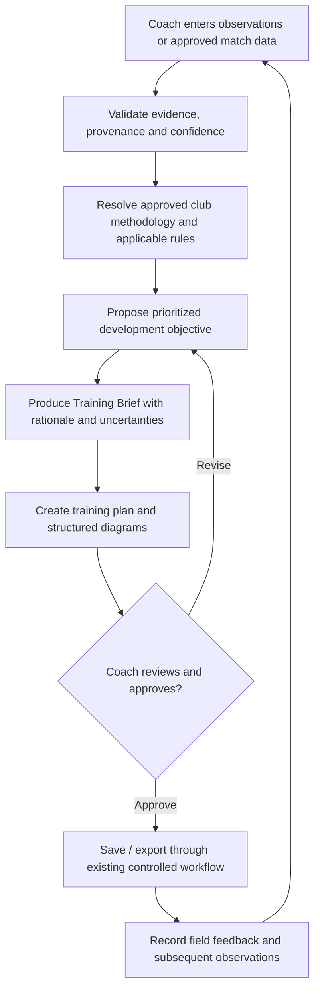

# TIE — Training Intelligence Engine: Product Specification v0.1

**Status:** Product and prototype specification, not a claim of fully implemented intelligence.  
**Parent:** Club Vivo (one modular Sports and Business Intelligence platform).  
**First implementation sport:** Soccer. **Long-term model:** methodology-configurable and extensible to additional sports.  
**Updated:** 2026-10-13.

## 1. Job to be done

**Turn observations of a real game into a useful, context-aware training decision that a coach understands, can adapt and approves.**

TIE should benefit a volunteer with two cones and a phone as well as an academy with analysts, cameras and detailed scouting, without requiring the latter's infrastructure for the former to get value.

TIE is **not** a universal philosophy, a referee, a replacement for professional coaching judgment, an unsupported predictive engine, or an autonomous system that assigns tasks to children.

## 2. Current capabilities vs future target

### Source-present today

- A Club Vivo TIE route (`/tie`) grouping existing soccer training tools.
- Existing team/equipment context, training creation, saved sessions and feedback/export surfaces.
- Existing backend deterministic/template-oriented generation and validated session structures, rather than a robust match-video AI engine.
- Backend methodology text records in `shared`, `travel`, and `ost` scopes; published/draft concepts with limited generation influence.
- Internal Training Brief validation/candidate/handoff helpers and a narrow request preview mode in SIC; **not** a complete public prescription service.
- Structured diagram concepts and renderer work; proposed DiagramSequence contracts are not necessarily shipped animation/runtime.

### Not implemented as a finished product

- Automated full-game tactical analysis and verified mistake detection.
- Full opponent scouting and match-to-match prescription across the week.
- Arbitrary club-selectable, version-controlled knowledge/methodology profiles.
- Multi-sport generation or a generic video data pipeline.
- Autonomous AI feedback loops with reliability measurements.
- A licensed third-party TIE API/SDK.

## 3. Proposed workflow

**MVP first:** coach-entered observations; no automatic game video analysis. The training recommendation should explain *why*, *which evidence*, *which philosophy/version* and *what remains uncertain*.

## 4. Hierarchy and methodology flexibility

A club might subscribe to a national federation framework, establish its own possession model, emphasize player creativity, or follow a combination of approved sources. TIE should support those approved models **without automatically treating any one as mandatory worldwide**.

Proposed **priority order**:
1. Applicable law, safeguarding, safety and enforceable event/competition rules.
2. Verified identity, organization permissions and verified evidence provenance.
3. Real constraints (ages, injuries/medical boundaries where appropriate, ability, available players, time, space, equipment).
4. Club-approved methodology profile and version.
5. Coach's immediate intent and tactical preferences.
6. Presentation and style choices.

If sources conflict, TIE must show the conflict or decline an unsafe recommendation. It may not invent accreditation or claim that a club methodology is officially endorsed by an association.

### Proposed `MethodologyProfile` (new design, not current API)

- `profileId`, server-owned tenant scope, owner, name, sport(s), version and lifecycle state.
- Approved origin/source references and review dates.
- Philosophy and learning/development principles.
- Preferred session shapes, tactical behaviors, playing model, pedagogical constraints.
- Age and program applicability.
- Coaching language and optional localization.
- Publisher/approver, timestamp and supersession trail.
- Explicit source mode and fallback behavior for missing or unapproved guidance.

**Safeguard:** free-form uploaded documents must never be treated as arbitrary instructions to override authorization, safety, data access or validated output schemas.

## 5. Canonical domain objects — proposed

These are conceptual contracts. Do **not** break existing `/session-packs` or create new public endpoints from this document alone.

| Object | Responsibility | MVP ownership |
| --- | --- | --- |
| `OrganizationContext` | Server-derived organization and policy context | Existing auth/entitlements, extended only by new approved backend |
| `CoachObservation` | Who observed what, when, team, match phase, examples and confidence | Coach-provided and editable |
| `MatchEvidence` | Evidence collection with timestamps and optional opponent observations | Proposed minimal schema |
| `MethodologyProfile` | Active approved philosophy with version and precedence | Proposed profile schema |
| `TrainingBrief` | Observed challenge, positive behaviors, recommendations, rationale, uncertainties, constraints | Extend internal candidate/handoff rather than duplicate |
| `TrainingPlan` | Existing session pack, drills, coaching points and renderable diagrams | Reuse current TIE creation/save contracts |
| `CoachApproval` | Accepted, revised or rejected suggestion and responsible reviewer | Proposed approval/audit record |
| `TrainingFeedback` | What happened in practice and what might change next | Adapt existing feedback path with review |

Each persisted record must have tenant-safe ownership, field validation, deletion/retention rules and audit policy before implementation.

## 6. A first real prototype

**Scenario:** An under-12 soccer team repeatedly lost possession while building from its defensive third. A coach enters two specific observations and one positive example, selects available field/equipment and indicates a next opponent presses high.

**Proposed inputs:**
- U12, 12 available players, 60 minutes, half field, 10 cones and eight balls.
- Observation A: poor support angles and three turnovers, with notes, not fabricated tracking statistics.
- Observation B: players often forced a forward pass under pressure.
- Positive evidence: effective switch of play at least twice (coach estimate).
- Optional next-opponent note with source and confidence; "unknown" is valid.
- Approved methodology: e.g., "develop scanning and supporting angles through games" or "emphasize structured build-up patterns."

**Proposed output:**
- A coach-editable training brief with two possible priorities and reasoned selection.
- An evidence note linking each proposal back to the original observations.
- A 60-minute validated training plan using available players/equipment/space.
- Clear coaching cues and simple structured diagrams.
- A visible notice that opponent notes are unverified coach-provided scouting data.
- A coach approval/edit/reject step and optional after-practice reflection.

**Core differentiation test:** For the **same evidence and constraints**, two truly different approved methodology profiles should produce **different valid training approaches**, while both satisfy the same safety and resource constraints. If only vocabulary changes, the feature has failed the test.

## 7. Thin-slice build sequence (solo developer)

| Slice | Engineering change | Proof of done |
| --- | --- | --- |
| T0 — Baseline | Audit existing session pack, Training Brief draft and methodology contracts | Source map and passing regression tests |
| T1 — Evidence intake | Narrow typed coach observations with validation and no tenant IDs from client | Invalid-input and tenant-boundary tests |
| T2 — Methodology selection | Server-selected, approved profile and deterministic comparison | Same evidence, two distinct valid methodologies |
| T3 — Explainable Training Brief | Structured rationale, uncertainties and coach edit/reject/approve | Human can review before action or save |
| T4 — Session handoff | Use existing creation route/contracts to build a plan and diagrams | Duration, age, equipment and save/export tests |
| T5 — Feedback | Capture coach outcome and evidence of usefulness | Time-saved and training-utility pilot evaluation |
| T6 — Video exploration | Rights/consent assessment, optional approved footage, measured model quality | Only after accuracy and privacy gates pass |

### Explicitly excluded from the earliest pilot

No uncontrolled LLM agent, production video ingestion, real-time player identification, child profiling, automatic medical or developmental diagnoses, autonomous opponent tracking or enterprise billing.

## 8. Acceptance tests and failure modes

- **Source honesty:** missing evidence produces an uncertainty flag, not a made-up match event.
- **Methodology:** unapproved or foreign-tenant philosophy cannot influence outputs.
- **Age/safety:** recommendations respect applicable safeguarding and sport/competition context; conflicting requirements are surfaced.
- **Constraints:** duration totals, player count, time, space and equipment must be feasible.
- **Coach agency:** no recommendation becomes an approved training plan without an explicit authorized human action.
- **Tenancy:** clients cannot submit arbitrary tenant identifiers; unauthorized org access is denied at API/storage boundaries.
- **Structured output:** unknown or invalid fields fail validation; diagram source is structured and reviewable.
- **Failure handling:** if external AI is unavailable, the system can fall back to safe deterministic assistance or fail transparently.
- **Costs:** inference/usage are metered and capped when models are added; logs omit identifiable child information.
- **Data rights:** video and member data have lawful use, notice/consent where required, access and deletion controls.
- **Quality:** a coach can explain why each prescribed activity addresses observed evidence; review does not depend on accepting AI output blindly.

## 9. Pilot metrics

Measure *real utility*, not vanity generation volume:

- Time to produce a practical plan compared with manual planning.
- Coach-rated usefulness and required corrections.
- Percentage of recommendations traceable to entered evidence.
- Percentage of sessions passing safety/resource validation.
- Differences between methodology profiles verified by independent coaches.
- Retention/weekly reuse, authorized-access failures and per-session cost.
- No unsupported claims of performance improvement without a credible study design.

## 10. Source links

- [Existing SIC Training Brief v1 contract](https://github.com/mrleom/sports-intelligence-cloud/blob/main/docs/api/training-brief-v1-contract.md)
- [Existing Methodology v1 contract](https://github.com/mrleom/sports-intelligence-cloud/blob/main/docs/api/methodology-v1-contract.md)
- [Existing Training Prescription direction](https://github.com/mrleom/sports-intelligence-cloud/blob/main/docs/product/club-vivo/training-prescription-layer.md)
- [Club Vivo Master Blueprint](club-vivo-master-blueprint.md)
- [System Architecture](../architecture/club-vivo-system-architecture.md)
